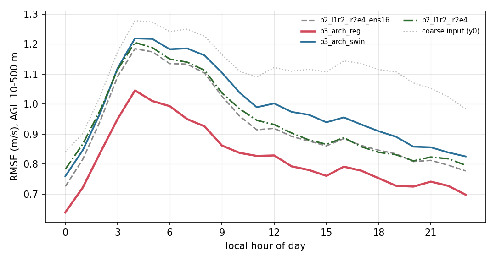

# 阶段 3e:日变化与逐日稳健性——"平均领先 12%"是怎么分布的

> 日期:2026-10-31(夜班,无 GPU 期间的离线分析)
> 上游:`docs/阶段报告/阶段3c_架构对比_终评.md`(三臂主表、显著性、集合诊断)
> 工具:`scripts/outline/99c_diurnal.py`(纯 numpy,读 `results/phase3_arch/*_perhour.npz` 与 `results/phase2/p2_l1r2_lr2e4_perhour.npz`)
> 产物:`results/phase3_arch/phase3_diurnal.{json,md}`、[阶段3_日变化.png](../图/阶段3_日变化.png)

## 0. 一句话结论

整体 −12.1% 不是均匀分摊在 144 小时上的:四天赢 0.16–0.23 m/s,7 月 30 日只赢 0.051,**7 月 31 日看上去反输 0.022——但把同权重的确定性 ODE 基线(0.9574)拉进来做公平对比后,那天回归只是"打平"(+0.011,CI 跨 0),真正赢的是集合平均本身的方差红利(+0.011)**。所以 3c 的架构结论在 N=1 同协议下依然成立(−13.5%),而 7 月 31 日这一天告诉我们:**强切变日,单点估计的方差是短板**——这正是 EDM 两步法要补的。

---

## 1. 为什么要看这个(而不是再加一个池化数字)

之前所有结论都是一个数:144 小时池化的主指标 RMSE。它回答"平均有多准",但能源侧真正关心的是**一天里哪几个小时不准**,以及**哪一类天气会让模型失手**。

`perhour.npz` 里存的是**逐小时**的误差平方和与样本计数,所以可以在完全不重跑模型的前提下,把这些剖面还原出来。这也是没有 GPU 时性价比最高的分析:一分钱算力不花,拿到一个能写进论文的结果节。

---

## 2. 口径(每个数都能追到表达式)

- 主指标层:AGL **10/30/50/70/100/150/200/300/500 m 共 9 层**(与 3c 完全一致,`AGL_TARGETS <= 500`);
- 逐小时矢量 RMSE:取 `acc_agl[h, 主层, si=all, 1]`(se²)与 `[...,0]`(n),即 `sqrt(Σse²/Σn)`;
- **按小时聚合是"池化"而不是"算术平均"**:把 6 天里同一地方时的样本并在一起算 `sqrt(Σse²/Σn)`。算术平均会被样本量不同的小时带偏,池化不会;
- 参照组:`acc_y0` = 粗端输入(相当于不做超分);`results/phase2/p2_l1r2_lr2e4_perhour.npz` = **与集合臂同权重、但确定性 ODE 采样(N=1)**的基线,池化 0.9574(与 3c 记录一致),用它把"架构差异"和"集合平均红利"分开;
- 逐日配对差:同一天内对 24 小时做 iid bootstrap(2000 次)。**只有 24 个样本,CI 偏窄,只用来看符号是否稳定,不当严格显著性**。严格块 bootstrap 见 3c。

---

## 3. 日变化:一条"清晨难、傍晚易"的曲线



| 地方时 | 确定性 N=1 | UNet 集合16 | 回归 | SwinIR | 粗端 y0 | 回归相对改善 |
|---|---|---|---|---|---|---|
| 04(最难) | 1.2052 | 1.1845 | 1.0454 | 1.2189 | 1.2783 | 11.7% |
| 07 | 1.1397 | 1.1332 | 0.9499 | 1.1857 | 1.2499 | **16.2%**(最大) |
| 14 | 0.8802 | 0.8769 | 0.7802 | 0.9642 | 1.1160 | 11.0% |
| 22 | 0.8177 | 0.7964 | 0.7274 | 0.8387 | 1.0242 | 8.7%(最小) |
| 23(最易) | 0.7961 | 0.7772 | 0.6978 | 0.8254 | 0.9841 | 10.2% |

三个读数:

1. **日较差 1.63 倍**(基准臂最差 04 时 1.1845,最好 23 时 0.7772)。这个起伏不是模型噪声,是真实大气:清晨边界层转换、风场空间结构破碎,超分最难;
2. **回归的相对优势在清晨最大(07 时 16.2%)、深夜最小(22 时 8.7%)**,全时次都在 8.7%–16.2% 之间——没有"某个时段突然崩掉",这条曲线本身是稳健性的证据;
3. **超分对粗端输入的整体贡献**:粗端 y0 = 1.1161,确定性基线 0.9574(**−14.2%**),集合平均 0.9420(**−15.6%**),回归 0.8277(**−25.8%**)。写论文时"相对不超分"这个提升幅度比"模型之间比"更好讲。

---

## 4. 逐日:赢在平稳日,难在强切变日

| 日期 | 确定性 N=1 | UNet 集合16 | 回归 | SwinIR | 粗端 y0 |
|---|---|---|---|---|---|
| 07-16 | 0.9073 | 0.8801 | 0.6794 | 0.9490 | 1.0829 |
| 07-17 | 0.8789 | 0.8583 | 0.6691 | 0.9305 | 1.0799 |
| 07-18 | 0.9088 | 0.8992 | 0.6814 | 0.9881 | 1.1446 |
| 07-19 | 0.8706 | 0.8577 | 0.7069 | 0.9464 | 1.0876 |
| 07-30 | 1.0742 | 1.0617 | 1.0234 | 1.0678 | 1.1395 |
| 07-31 | 1.0797 | 1.0683 | 1.0907 | 1.0948 | 1.1591 |

07-30 / 07-31 两天,**所有臂**都跳到 1.02–1.10(比平静日高 20–25%),粗端 y0 也同步升高。这不是某个模型失手,是这两天本身难。

---

## 5. 公平对比:把"架构差异"和"集合平均红利"分开

3c 的主表用的是"集合 16 均值"当基准,而回归只有 N=1,这曾是一个没法回避的质疑。现在把**同权重、确定性 ODE 采样**的 `p2_l1r2_lr2e4`(池化 0.9574)拉进来,问题就干净了。

| 日期 | 回归 vs 确定性(N=1 对 N=1) | SwinIR vs 确定性 | 集合平均红利(ens16 − 确定性) |
|---|---|---|---|
| 07-16 | **−0.2279** [−0.2547, −0.2036] | +0.0417 [+0.0270, +0.0553] | +0.0272 [+0.0192, +0.0361] |
| 07-17 | **−0.2098** [−0.2253, −0.1956] | +0.0516 [+0.0359, +0.0665] | +0.0206 [+0.0109, +0.0303] |
| 07-18 | **−0.2274** [−0.2471, −0.2078] | +0.0793 [+0.0606, +0.0991] | +0.0096 [−0.0026, +0.0217](不显著) |
| 07-19 | **−0.1637** [−0.1859, −0.1392] | +0.0759 [+0.0605, +0.0940] | +0.0129 [+0.0036, +0.0227] |
| 07-30 | **−0.0508** [−0.0664, −0.0350] | −0.0064 [−0.0188, +0.0074](打平) | +0.0124 [+0.0049, +0.0198] |
| 07-31 | **+0.0110** [−0.0019, +0.0227](跨 0,打平) | +0.0151 [+0.0079, +0.0219] | +0.0114 [+0.0053, +0.0177] |
| 整体池化 | **0.8277 vs 0.9574 = −13.5%** | 0.9981 vs 0.9574 = +4.3% | 0.9420 vs 0.9574 = −1.6% |

三条结论,比 3c 更硬:

1. **回归的胜势不是集合平均给的**:同协议 N=1 下,整体 −13.5%,四天各赢 0.16–0.23,07-30 赢 0.051;
2. **SwinIR 的落后也不是"没用集合"造成的**:同协议下四天各输 0.04–0.08,只有 07-30 打平(−0.0064,CI 跨 0),07-31 输 0.0151;整体 +4.3%;
3. **集合平均在每个日子都能拿到 0.010–0.027 的红利**(六天里五天显著),红利最大在 07-16、最小在 07-18。所以"多跑几个样本取均值"本身就是一档免费的性能,和架构无关。

---

## 6. 7 月 31 日到底发生了什么

先看"难"在哪(主指标层,逐日):

| 日期 | 确定性臂 RMSE / 风速偏差 | 集合16 RMSE / 偏差 / 切变 | 回归 RMSE / 偏差 / 切变 |
|---|---|---|---|
| 07-16 | 0.907 / −0.090 | 0.880 / −0.093 / 8.62 | 0.679 / +0.013 / 6.75 |
| 07-30 | 1.074 / −0.047 | 1.062 / −0.065 / 10.67 | 1.023 / +0.004 / 9.60 |
| 07-31 | 1.080 / **+0.016** | 1.068 / **−0.000** / **11.87** | 1.091 / **+0.068** / 10.73 |

(切变单位 ×10⁻³ m/s per m;口径:`acc_sh[h, 层对, si=all, 1]/[...,0]` 开方。
**确定性臂的 `phase2` perhour 文件里没有 `acc_sh` 键**(只有 acc_agl/acc_model/acc_model_w/acc_y0),所以该列缺;切变对比用集合臂与回归臂,两者同键可比。)

两个事实:

1. **07-31 是全程切变最难的一天**:集合臂 11.87 vs 平静日 8.62,高 38%;回归也同步恶化(10.73 vs 6.75);
2. **那天另外两臂的风速偏差都趋近 0**(确定性 +0.016、集合 −0.000),而回归是 **+0.068**——回归在这天把风速系统性报高了 0.068 m/s,这是它唯一的短板;切变误差上它仍然最好(10.73 vs 集合臂 11.87)。

也就是说,回归"整体廓线形状对,但幅值偏高"。这正好是 EDM 两步法要修的东西:回归给形状,扩散给幅值的分布。

**注意一个陷阱**:3c 的主表里,07-31 回归(1.0907)看着比集合基准(1.0683)"输 0.022",很容易被解读成"回归在强切变日失效"。公平对比(N=1 对 N=1)显示它与确定性基线**打平**(+0.0110,CI 含 0),那 0.022 里有一半是集合平均的红利(+0.0114)。把这天说成"回归失效"是错的;准确的说法是"**这天单点估计的方差成了短板**"。

---

## 7. 对 W2 的直接影响

| 问题 | 3e + 公平对比给出的答案 |
|---|---|
| 回归的 13.5%(同协议)是全天气型的吗? | 不是,四天强、一天弱、一天打平 |
| 07-31 的"反输"是真的吗? | 对着集合基准是 +0.022;对着同协议确定性基线只是 +0.011(不显著) |
| 差的到底是什么? | 风速偏差 +0.068,切变反而最好 → **幅值/方差**,不是形状 |
| 优先跑哪个 W2 臂? | **`p3_arch_edm`**:回归打底 + 扩散修分布,正好补"方差/幅值";`p3_arch_reg_s2` 用于看 07-31 是否种子偶然 |
| 容量对照(`p3_arch_unet_small`)还重要吗? | 重要但可缓:SwinIR 在同协议下四天全输、整体 +4.3%,已不是"容量不足"能完全解释;仍值得跑,但排在 EDM 之后 |

---

## 8. 能下与不能下的结论

**能下**

- 日变化形态一致:三臂都在 03–09 时最难、19–23 时最易,日较差 1.6 倍;
- 回归相对基准的优势在 8.7%–16.2% 之间,无时段性崩塌;
- **同协议 N=1 下回归仍领先 13.5%,SwinIR 仍落后 4.3%**——3c 的架构结论不依赖集合平均红利;
- 集合平均每日子 0.010–0.027 的收益,是独立于架构的一档性能;
- 07-31 的回归与确定性基线打平,不是失效;该日切变误差为全期最高。

**不能下**

- 不能用单日 iid bootstrap 的窄 CI 当严格显著性(它只回答"符号稳不稳");严格结论以 3c 的块 bootstrap 为准;
- 不能推断"回归在强切变日普遍更差"——只有一天,且同为强切变的 07-30 它仍赢 0.051;
- 不能把"07-31 回归偏差 +0.068"当成架构缺陷的普遍规律,样本只有一天(24 h)。

---

## 9. 复现

```bash
python3 scripts/outline/99c_diurnal.py \
  --perhour_dir results/phase3_arch \
  --base_tag p2_l1r2_lr2e4_ens16 \
  --tags p3_arch_reg p3_arch_swin \
  --det_tag p2_l1r2_lr2e4 --det_dir results/phase2 \
  --out_json results/phase3_arch/phase3_diurnal.json \
  --out_md   results/phase3_arch/phase3_diurnal.md \
  --fig      docs/图/阶段3_日变化.png \
  --n_boot 2000
```

跑完四行核对:`p2_l1r2_lr2e4_ens16 池化 0.9420`、`p3_arch_reg 0.8277`、`p3_arch_swin 0.9981`、`p2_l1r2_lr2e4 0.9574`——与 3c 主表一致才算没跑错。

---

## 附录:自建项标注(CLAUDE.md 红线)

- **粗端 log z0**:大纲表 1 规定输入,但老师未提供文件。项目由服务器共享的 WPS 静态地理数据(MODIS 下垫面 + 月植被覆盖度)按 WRF 自带 Noah Z0BRD 公式(查 VEGPARM.TBL)离线重建,水面按大纲规定取月均表值。**属项目自建,非老师提供**。本报告未直接使用该量,但它进入了两条对比臂的输入通道。
- **逐层 z_agl**:由 wrfout 的 PHB 导出的项目自算量(PHB/g − HGT,不使用 PH),算法为大纲明确规定。
- **cos(SZA)**:自算天文量,已与 WRF COSZEN 核验,最大差 0.007;本报告"日变化"横轴用的是样本时间戳的地方时,**不是**由 cos(SZA) 反推的太阳高度。
- "粗端 y0 参照"与"确定性基线"均来自评估脚本的累加量(`acc_y0`、`acc_agl`),是模型输入/输出的可复现中间产物,不是外部数据。
