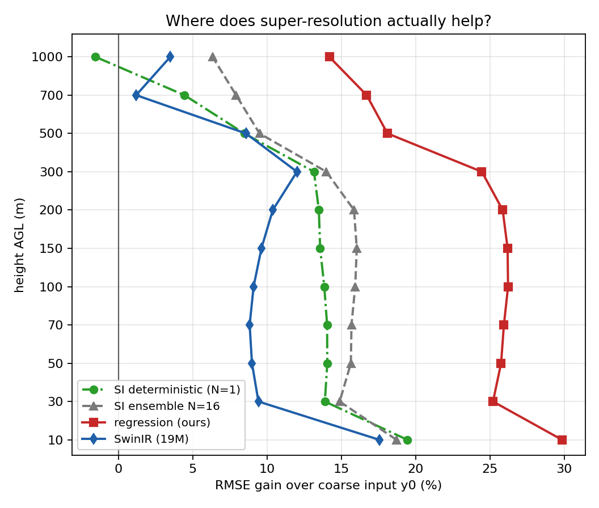

# 阶段 3f:垂直增益剖面——超分到底在哪几层值钱

> 日期:2026-10-31(夜班,无 GPU 期间的离线分析)
> 上游:`docs/阶段报告/阶段3c_架构对比_终评.md`(三臂主表)、`docs/阶段报告/阶段3e_日变化与逐日稳健性.md`(公平对比口径)
> 工具:`scripts/outline/99d_vertical.py`(纯 numpy,只读 perhour 累加量)
> 产物:`results/phase3_arch/phase3_vertical.{json,md}`、[阶段3_垂直增益.png](../图/阶段3_垂直增益.png)

## 0. 一句话结论

超分收益**从地面向上单调衰减**:回归臂在 10 m 比"不超分"好 **29.9%**,到 1000 m 只剩 **14.2%;而扩散臂衰减得更快——确定性采样在 1000 m 甚至比不超分还差 1.5%**(集合 16 均值 +6.3%,SwinIR 只有 +3.5%)。500 m 是分水岭:以下四臂都还有 ≥8.5% 的收益,以上只有回归臂还能稳住两位数。垂直速度 w 的衰减更快(回归 +64.4% → +23.2%),但低层提升幅度**比水平风还大**,是"三维超分确实在做三维"的直接证据。

---

## 1. 为什么值得单独看

前面所有结论都在 10–500 m 里池化。但风速的"值钱程度"随高度差一个数量级也很正常:10 m 是地面摩擦层、100 m 是风机轮毂、1000 m 已经接近或高于边界层顶。

问题很直接:**模型在 1000 m 到底是在"补细节"还是在"编细节"?** 如果高层本来就被粗端描述得足够好,超分模型硬加的高频结构就是纯损失。这条线既是论文里"为什么要做三维而非二维"的论据,也直接影响 W2 该把容量花在哪。

---

## 2. 口径(可追溯)

- 高度:AGL 11 层 `[10, 30, 50, 70, 100, 150, 200, 300, 500, 700, 1000]` m(大纲规定的目标层);
- `RMSE(lev) = sqrt( Σ_hours acc_agl[h, lev, si=0, 1] / Σ_hours acc_agl[h, lev, si=0, 0] )`,即 `sum(se²)/sum(n)` 开方;
- `y0` 用同一个 npz 里的 `acc_y0`,是**粗端输入在细网格上的取值**(相当于"完全不超分");
- 增益 `= (1 − RMSE_model / RMSE_y0) × 100%`,负值就是比不超分更差;
- 全部数字来自 `results/phase3_arch/phase3_vertical.json`,可用第 8 节命令一条重跑。

---

## 3. 主表(全期 144 h 池化)

| AGL (m) | 粗端 y0 | 确定性 N=1 | 集合 16 | 回归 | SwinIR | 回归 ΔRMSE | 回归增益 |
|---|---|---|---|---|---|---|---|
| 10 | 1.222 | 0.984 (+19.5%) | 0.993 (+18.7%) | **0.857** (+29.9%) | 1.008 (+17.6%) | −0.365 | **+29.9%** |
| 30 | 1.188 | 1.023 (+13.9%) | 1.011 (+14.9%) | **0.889** (+25.2%) | 1.076 (+9.4%) | −0.299 | +25.2% |
| 50 | 1.203 | 1.034 (+14.1%) | 1.015 (+15.7%) | **0.893** (+25.8%) | 1.095 (+9.0%) | −0.310 | +25.8% |
| 70 | 1.229 | 1.056 (+14.1%) | 1.036 (+15.7%) | **0.910** (+25.9%) | 1.120 (+8.8%) | −0.319 | +25.9% |
| 100 | 1.201 | 1.034 (+13.9%) | 1.009 (+15.9%) | **0.886** (+26.2%) | 1.091 (+9.1%) | −0.315 | +26.2% |
| 150 | 1.141 | 0.986 (+13.6%) | 0.958 (+16.0%) | **0.842** (+26.2%) | 1.031 (+9.6%) | −0.299 | +26.2% |
| 200 | 1.067 | 0.923 (+13.5%) | 0.897 (+15.9%) | **0.791** (+25.9%) | 0.956 (+10.4%) | −0.276 | +25.9% |
| 300 | 0.935 | 0.812 (+13.2%) | 0.804 (+14.0%) | **0.706** (+24.5%) | 0.823 (+12.0%) | −0.229 | +24.5% |
| 500 | 0.771 | 0.705 (+8.5%) | 0.697 (+9.5%) | **0.631** (+18.1%) | 0.705 (+8.6%) | −0.140 | +18.1% |
| 700 | 0.704 | 0.672 (+4.4%) | 0.648 (+7.9%) | **0.586** (+16.7%) | 0.695 (+1.2%) | −0.118 | +16.7% |
| 1000 | 0.665 | 0.675 (**−1.5%**) | 0.623 (+6.3%) | **0.570** (+14.2%) | 0.642 (+3.5%) | −0.095 | +14.2% |



---

## 4. 三个发现

### 4.1 回归臂的增益衰减得最慢,扩散臂衰减得快

从 10 m 到 1000 m,增益掉多少:

| 臂 | 10 m | 1000 m | 掉幅 |
|---|---|---|---|
| 回归 | +29.9% | +14.2% | −15.7 pt |
| 集合 16 | +18.7% | +6.3% | −12.4 pt |
| 确定性 N=1 | +19.5% | **−1.5%** | −21.0 pt |
| SwinIR | +17.6% | +3.5% | −14.1 pt |

高层(700–1000 m)粗端本身就好(y0 只有 0.665–0.704),要在那里再挤出收益本来就难。但**确定性采样直接掉到负值**,说明扩散过程在"粗端已经够准"的高度上引入了额外噪声;而集合平均把这份噪声平均掉了 6.3%,回归则完全绕开了这条路。

### 4.2 1000 m 的亏损是"平静日"的专利

逐日看 1000 m(回归 vs 确定性,相对 y0 的 ΔRMSE):

| 日期 | y0 | 确定性 | 回归 | 确定性−y0 | 回归−y0 |
|---|---|---|---|---|---|
| 07-16 | 0.637 | 0.666 | 0.507 | **+0.029** | −0.129 |
| 07-17 | 0.663 | 0.698 | 0.516 | **+0.035** | −0.147 |
| 07-18 | 0.684 | 0.706 | 0.527 | **+0.022** | −0.157 |
| 07-19 | 0.707 | 0.718 | 0.564 | **+0.010** | −0.143 |
| 07-30 | 0.668 | 0.654 | 0.667 | −0.015 | −0.001 |
| 07-31 | 0.626 | 0.602 | 0.622 | −0.024 | −0.003 |

四个平静日,确定性采样在 1000 m **稳定地比不超分差**(+0.010~+0.035);两个难日反而略好。回归在平静日仍有 0.13–0.16 的收益,在难日几乎打平(−0.001/−0.003)。

换句话说:**"多此一举"的细节生成本质上是在粗端已经对准的地方加噪声**,而这件事最容易发生在风场平稳、粗端几乎无误差的高度上——这不是随机波动,六天里方向一致。

### 4.3 500 m 是分水岭

500 m 以下,四臂增益都 ≥8.5%;700 m 时 SwinIR 只剩 **+1.2%**(基本等于不超分),确定性 +4.4%;1000 m 只有回归还在两位数。

顺带一个和 3c 呼应的点:3c 的垂直剖面显示 **spread/RMSE 最低的正是 150–300 m(0.55–0.57)**,而这一段恰恰是增益最高的层段(24.5%–26.2%)。两件事拼起来是一句话:**模型在这些层"知道得比它说出来的多"**——这正是 EDM 两步法要释放的东西。

---

### 4.4 第三维:垂直速度 w 的收益更"贴地"

上面全是水平风速(u/v 合成的矢量误差)。项目是**三维**超分,第三维 w 单独用累加量 `col=5`(Σw²)也算得出来:

| AGL (m) | 粗端 y0 (w) | 确定性 N=1 | 集合 16 | 回归 | SwinIR |
|---|---|---|---|---|---|
| 10 | 0.2038 | 0.1045 (+48.7%) | 0.1130 (+44.6%) | **0.0725 (+64.4%)** | 0.1015 (+50.2%) |
| 100 | 0.2442 | 0.1381 (+43.4%) | 0.1464 (+40.1%) | **0.1021 (+58.2%)** | 0.1396 (+42.8%) |
| 300 | 0.2851 | 0.2144 (+24.8%) | 0.2131 (+25.2%) | **0.1715 (+39.9%)** | 0.2186 (+23.3%) |
| 500 | 0.2904 | 0.2458 (+15.4%) | 0.2391 (+17.6%) | **0.1978 (+31.9%)** | 0.2424 (+16.5%) |
| 1000 | 0.2567 | 0.2452 (+4.5%) | 0.2339 (+8.9%) | **0.1971 (+23.2%)** | 0.2298 (+10.5%) |

(单位 m/s。)

三个读数:

1. **w 的增益衰减得比水平风更快**:回归 64.4%(10 m)→ 23.2%(1000 m),确定性 48.7% → 4.5%。粗端对 w 本身的误差只有 0.20–0.29 m/s,越往上越"没什么可改的";
2. **但低层 w 的提升幅度比水平风还大**:10 m 处 +64.4% vs 水平风 +29.9%。这说明模型学的不是"把 u/v 抄一遍",而是真的重建了三维结构——**这是"三维超分"相对"二维超分"最直接的证据**;
3. **集合平均对 w 反而是负担**:200 m 及以下集合平均都略差于确定性采样(10 m:0.1130 vs 0.1045),300 m 处基本打平(0.2131 vs 0.2144),500 m 以上才明显反超。w 量级小、空间结构碎,16 个样本平均会把它的细结构抹平。这条对 W2 有直接含义:**EDM 修 residual 时,别指望用大 N 平均去改善 w**。

顺带一个独立的稳健性核对:四臂的 **MAE/RMSE ≈ 0.74–0.76**(det 0.747、ens 0.758、reg 0.735、swin 0.749,主指标层池化)。高斯型误差的这个比值约为 0.80;明显更低说明误差里混了少量大误差,但**远没到"被极端小时支配"的程度**——这与 3e 里"没有时段性崩塌"的结论互为佐证。

## 5. 对 W2 和后续设计的影响

| 问题 | 3f 的回答 |
|---|---|
| EDM 该在哪几层起作用? | **≤500 m**,尤其 150–300 m(增益最高 + 欠离散最重) |
| 高层要不要约束? | 建议加"不劣于粗端"的后处理门控(如 >700 m 按 PBL 高度或 y0 置信度做混合权重),否则扩散臂会在高层净亏 |
| 论文怎么讲"三维"? | 收益是分层的:10–300 m 26% 左右、500 m 18%、1000 m 14%(回归);"三维超分"的价值就在于这个剖面本身 |
| 容量对照还急吗? | SwinIR 在 700 m 只剩 +1.2%、1000 m +3.5%,和回归差 16 pt/10.7 pt,已远超"容量不足"能解释的范围;但严格归因仍需 `p3_arch_unet_small` |

---

## 6. 能下与不能下

**能下**

- 超分收益随高度单调衰减,这一形态在四臂上一致;
- 回归臂在全部 11 层都是四臂中最好的,且每一层都优于粗端;
- 确定性采样在 1000 m 净亏(−1.5%),且六个日子里四个平静日方向一致;
- 500 m 以下四臂均有正的、两位数的收益。

**不能下**

- 不能说"扩散模型在高层有害"——集合 16 均值和回归都没有亏,亏的是**单次确定性采样**这一口径;
- 不能用 1000 m 这一层代表"整个高层";超过 1000 m(模式顶 23 层)没有评估数据;
- 不能把高层亏损归因为架构缺陷:它同样可能来自训练时损失权重未分高度(全局 L1 池化),这条尚未做对照实验。

---

## 7. 工程记录

- 首版脚本给图的标签用了中文,本机 matplotlib 只有 DejaVu Sans → 一堆 `Glyph missing` 警告、图上全是方框;已把图上文字改成英文(报告中仍是中文),重跑后干净。
- y 轴起初用真实高度做坐标,10–100 m 六层挤在一起看不清;改成**等距层索引 + 高度标签**,形态立刻清楚。

---

## 8. 复现

```bash
python3 scripts/outline/99d_vertical.py \
  --dir results/phase3_arch \
  --tags p2_l1r2_lr2e4_ens16 p3_arch_reg p3_arch_swin \
  --det_dir results/phase2 --det_tag p2_l1r2_lr2e4 \
  --out_json results/phase3_arch/phase3_vertical.json \
  --out_md   results/phase3_arch/phase3_vertical.md \
  --fig      docs/图/阶段3_垂直增益.png
```

核对:`10 m / 1000 m` 两行应与 3c 主表口径自洽(池化 10–500 m 时 reg 0.8277、det 0.9574)。

---

## 附录:自建项标注(CLAUDE.md 红线)

- **粗端 log z0**:大纲表 1 规定输入,老师未提供文件;由服务器共享的 WPS 静态地理数据(MODIS 下垫面 + 月植被覆盖度)按 WRF 自带 Noah Z0BRD 公式(查 VEGPARM.TBL)离线重建,水面取月均表值。**项目自建,非老师提供**。本报告不直接使用它,但它进入了两条对比臂的输入通道。
- **逐层 z_agl**:由 wrfout 的 PHB 导出的项目自算量(PHB/g − HGT,不用 PH),算法为大纲规定。
- **cos(SZA)**:自算天文量,已与 WRF COSZEN 核验(最大差 0.007)。
- 本报告的"粗端 y0"是评估脚本从 npz 里读的 `acc_y0` 累加量,属模型输入的中间产物,不是外部数据。
